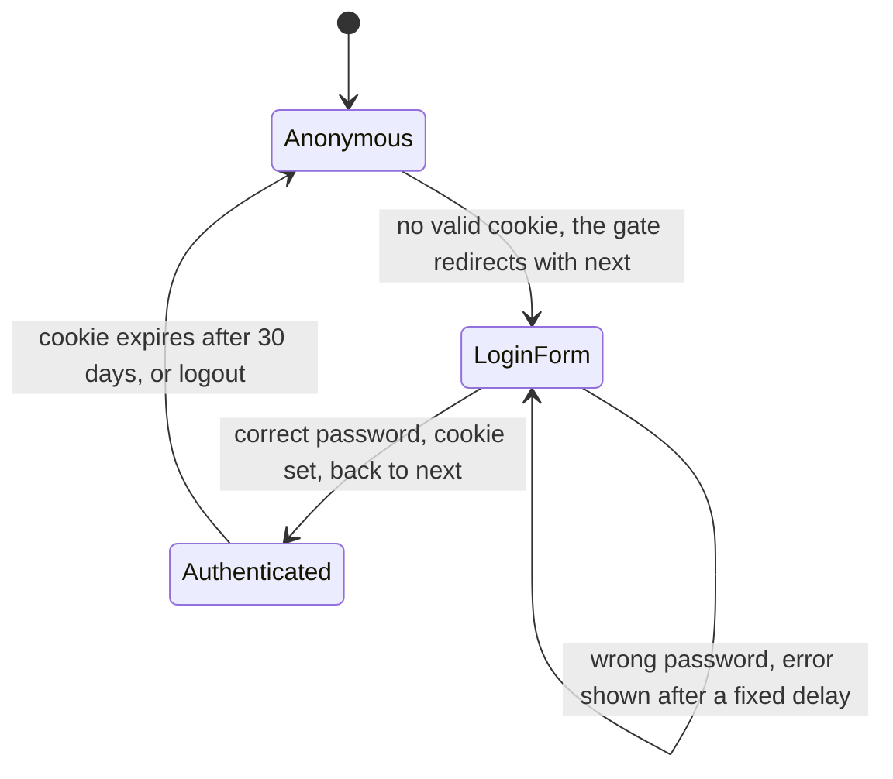
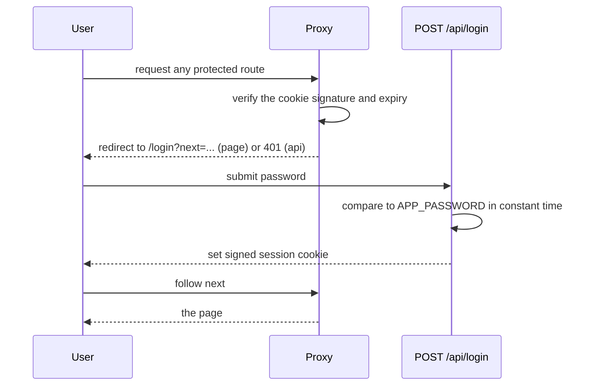
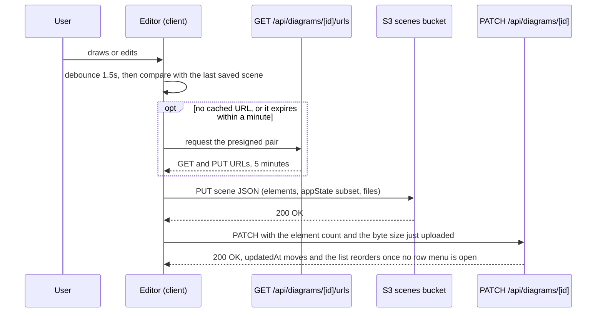
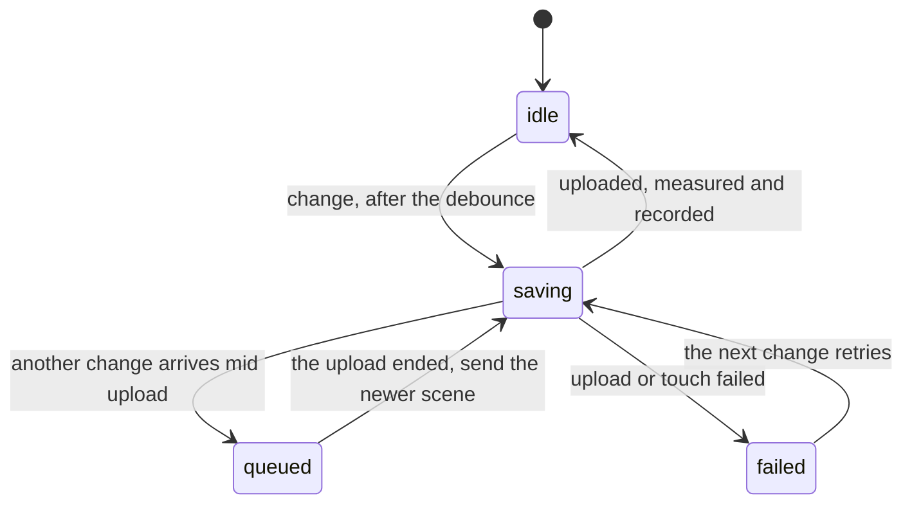

# app: flows

Both flows are built.

## Login

The gate is `src/proxy.ts` and runs on every request whose path is not on the allowlist: `/login`, `/api/login`, `/_next/*` and root-level files.

## Save a diagram

Runs on every `onChange`, debounced 1.5 seconds, from the moment the canvas is painted by an initialised editor rather than from the moment it is open: before that the editor holds the previous scene or its own initial empty one, and a report from there would be saved over the one being opened.
The presigned pair comes with the scene at open and is reused until it is close to expiring, so a save is one PUT and one PATCH.

One upload runs at a time, and the editor never loses a change made during one.

Leaving a canvas stops its saver: the pending change is handed over at once, and what the saver holds keeps uploading, a queued scene included, with every status reported, so the indicator reads how it ended when the user comes back.
A stopped saver takes no new input and never retries a failure, the warning on leaving the page holds until it has drained, and the indicator never takes its report over one from a newer saver.
Every status report also keeps the diagram's tab if it is still open as a preview, and never opens a tab the user has closed.
Opening a diagram never saves it: the editor's first report after a mount becomes the baseline when it changes no element.
Deleting a diagram, or a folder with diagrams under it, abandons their savers before the DELETE is sent, so nothing is written back.
A locked diagram never enters this flow at all: the editor mounts no saver, `/urls` signs no upload, and the PATCH is refused by a condition on the item, so a browser that locked nothing is stopped too.
A library canvas runs the same flow with the same machine: `/urls` hands back a second pair, and the injected write derives the items from the frames in memory, PUTs the canvas, PUTs the items and PATCHes the counts with `itemCount`.
It is one save, so a failure anywhere in it is one failed save that repeats both idempotent PUTs, exactly as a PUT landing with a failed PATCH already does.
